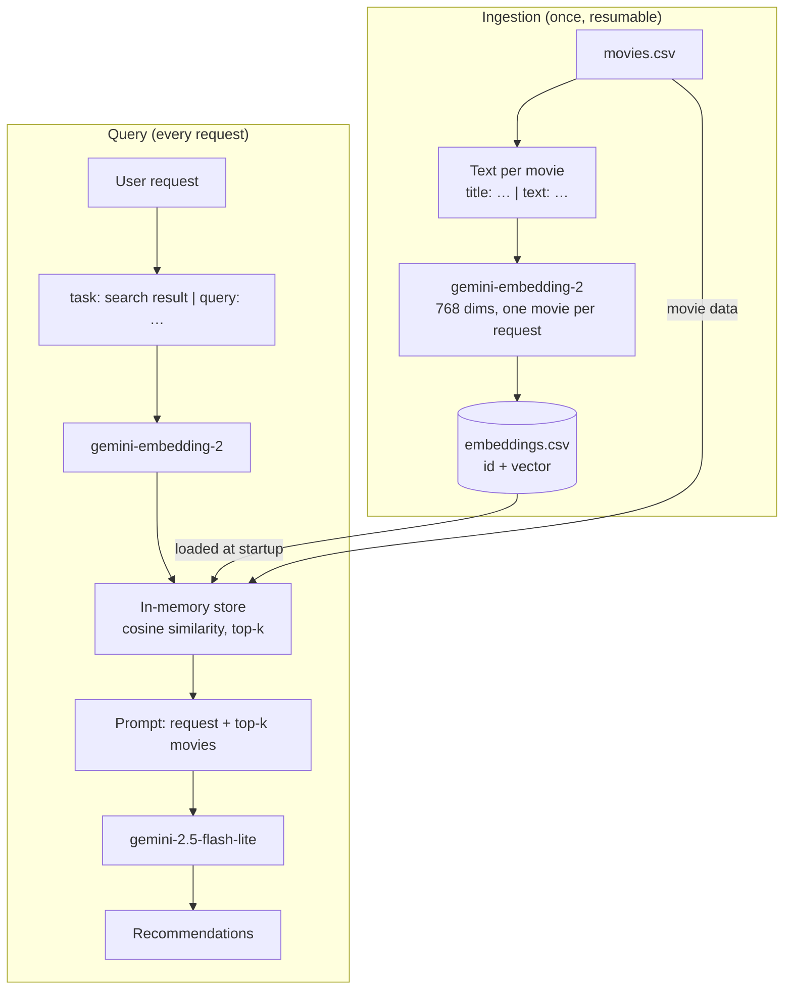

# Architecture

The app has two paths that only meet in the vector store: ingestion fills it, queries read from it.

## Ingestion

Runs once, not on every request. For each movie in `movies.csv` it builds a text from the title, tagline, genres, keywords and overview, and sends it to `gemini-embedding-2`, which returns a vector of 768 numbers. Movies with a similar mood end up with vectors pointing in similar directions.

The vectors are saved to `data/embeddings.csv` next to the movie id. Embedding is the slow, rate-limited part (one request per movie, 1,000 requests a day on the free tier), so it can stop and resume where it left off, and the app only loads the file on startup.

## Query

For each request:

1. The request is embedded with the same model. It has to be the same one: vectors from different models live in different spaces and can't be compared.
2. The in-memory store compares that vector with every movie vector using cosine similarity and keeps the top k.
3. The request and those k movies go into a prompt for `gemini-2.5-flash-lite`, which picks a few and explains why each one fits.

## Prefixes

A request and a movie are different kinds of text. The request says what you want ("something sad for a rainy day"); the overview says what happens in the movie. `gemini-embedding-2` takes a prefix that tells it which one it's looking at:

- movie: `title: {title} | text: {tagline, genres, keywords, overview}`
- request: `task: search result | query: {request}`

All movies and all requests must use the same format, otherwise the vectors stop being comparable.

## Why the LLM shouldn't make up movies

It only gets the k retrieved movies and is told to choose from them, so its answer is grounded in the dataset instead of whatever it remembers. That reduces made-up titles but doesn't rule them out, so every recommended title is checked against the retrieved list before it's returned.

## First numbers

`scripts/embedding_experiment.py` embeds one request, "a sad movie to watch on a rainy day with my girlfriend", and three movies:

| Movie | With prefixes | Without prefixes |
|---|---|---|
| The Notebook | 0.6847 | 0.6955 |
| Blue Valentine | 0.6659 | 0.6785 |
| Crank | 0.5923 | 0.6066 |

The order is right, but the scores are close together: an unrelated action movie still gets 0.59, since everything is English text about movies. The ranking is what matters, not the absolute value, which makes a fixed similarity threshold risky. With a single request the prefixes barely change anything; they'll be compared on the evaluation queries.
